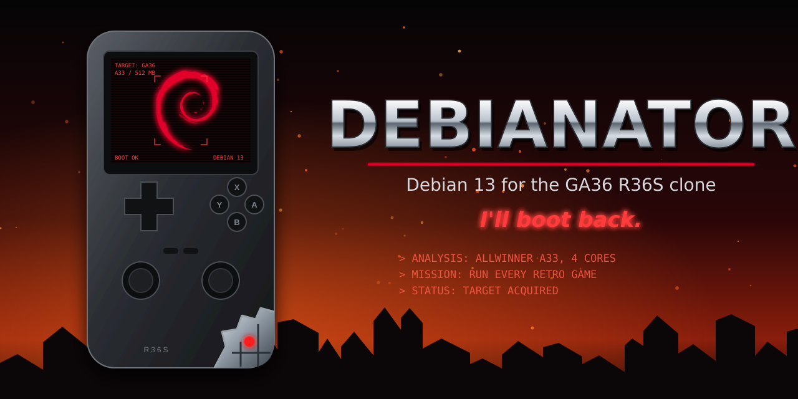

# Debianator

Debian-based firmware for the **GA36-MB** R36S clone (Allwinner A33, 512 MiB RAM), the board sold as an "R36S"
whose stock system is a vendor EmuELEC on a Linux 3.4 kernel. No existing R36S custom firmware supports it; they
all target the Rockchip RK3326.

**Status: v1.1, tested on GA36 board V1.0.** Download the image from the
[releases page](https://github.com/Bepok/Debianator/releases) and follow [Install](#install).

## What you get

- EmulationStation with RetroArch for the systems below, plus DOS, Heroes of Might and Magic III, and N64 and PSP
  as experimental.
- Both analog sticks, in games that use them and in the menus; on PlayStation the pad is a DualShock.
- Speaker and headphones, volume keys, brightness on FN+Vol.
- Sleep and wake on a short press of the power key, power off when held; battery level in the menu.
- A charge screen with the battery level when the charger is plugged in while the console is off.
- Saves and save states on the `ROMS` partition, kept when you update.
- Runs from the SD card only: the stock card and the console itself are not changed.
- Under the hood: mainline Linux 6.18 LTS and U-Boot, Debian trixie armhf, EmulationStation (fcamod), RetroArch.

| System | ROM folder | File types | Core |
|---|---|---|---|
| NES | `nes` | `.nes` `.zip` | Nestopia |
| Game Boy, Game Boy Color | `gb`, `gbc` | `.gb`, `.gbc`, `.zip` | Gambatte |
| Game Boy Advance | `gba` | `.gba` `.zip` | gpSP |
| Super Nintendo | `snes` | `.smc` `.sfc` `.zip` | Snes9x 2010 |
| Mega Drive | `megadrive` | `.md` `.gen` `.smd` `.bin` `.zip` | PicoDrive |
| Master System, Game Gear | `mastersystem`, `gamegear` | `.sms`, `.gg`, `.zip` | PicoDrive |
| PC Engine | `pcengine` | `.pce` `.zip` | Beetle PCE Fast |
| PlayStation | `psx` | `.cue` `.chd` `.pbp` `.m3u` | PCSX ReARMed |
| DOS | `pc` | `.zip` `.dosz` `.exe` `.com` `.bat` `.conf` | DOSBox Pure |
| Nintendo 64 (experimental) | `n64` | `.n64` `.z64` `.v64` `.zip` | ParaLLEl N64 |
| PSP (experimental) | `psp` | `.iso` `.cso` `.pbp` `.chd` | PPSSPP |
| Heroes of Might and Magic III | `heroes3` | the GOG data folders | VCMI |

- **Not yet:** Wi-Fi and networking; arcade and Nintendo DS.
- **Known limitations:** screen tearing is possible in 50 Hz (PAL) games, which run without vsync lock; button
  remapping in ES is not saved; a faint hiss while the ES menu is open; DOS games run at the speed of a 486
  (Doom about 19 fps), limited by the CPU.

## Install

1. **Keep the stock card.** Back it up first (for example `sudo dd if=/dev/sdX of=stock.img bs=4M status=progress`)
   and put it away; this firmware goes on a *separate* card.
   - **Card size:** 4 GB minimum, 8 GB or more recommended.
   - The image takes 3.51 GB.
   - The `ROMS` partition is made only when at least 1 GiB is left after it, which means cards from 4.58 GB.
   - On a 4 GB card, ROMs go to the system partition instead, which has about 1.7 GiB free. It is ext4, which only
     a Linux PC can write: on Windows or macOS use a card of 8 GB or more.
2. Check that you have the right console: this works only on the GA36-MB clone (Allwinner A33). The original R36S
   and most clones use the Rockchip RK3326 and will not boot it (see [FAQ](#faq)). The marking on the board reads
   `GA36-MB V1.0-20250730`, `V1.1-20251025` or `V1.2-20260416`. Only V1.0 is tested.
3. Download `debianator-vX.Y.Z.img.xz` and `SHA256SUMS` from the release, then check them:
   `sha256sum -c SHA256SUMS`.
4. Flash the `.img.xz` with balenaEtcher or Raspberry Pi Imager (both take it as is), or on Linux:
   - Find the card with `lsblk` (`sdX` below): dd overwrites whatever it is given.
   - Unmount its partitions first, since a card written while mounted can end up unbootable:
     `for p in /dev/sdX?; do udisksctl unmount -b $p; done` ("not mounted" errors are fine).
   - Write it: `xzcat debianator-vX.Y.Z.img.xz | sudo dd of=/dev/sdX bs=4M conv=fsync status=progress`
   - Eject it before removing the card: `sudo eject /dev/sdX`
5. Insert the card and power on (hold the power key for more than 1 s). The first boot creates the `ROMS`
   partition on the rest of the card; put ROMs in its system folders (`/roms/<system>`) and BIOS files in
   `/roms/bios`.

- **Upgrading:** writing a new release with `xzcat ... | sudo dd` keeps the `ROMS` partition and its files.
  Raspberry Pi Imager erases the whole card first, so ROMs and saves are lost. Other flashers may do the same.
  Whichever you use, copy everything off `ROMS` (at least the `saves` and `heroes3/Saves` folders) before you upgrade.
- **Back to stock:** power off and insert the stock card. Nothing on the console itself is changed.
- **V1.1 and V1.2 boards:** untested. If you try one, a test report is welcome (see [FAQ](#faq)).

## Controls

### In games

| Buttons | What it does |
|---|---|
| FN+Start | quit the game, back to the game list |
| FN+X | RetroArch menu |
| FN+R1 / FN+L1 | save state / load state |
| FN+Left / FN+Right | previous / next state slot |
| Vol+ / Vol- | volume |
| FN+Vol+ / FN+Vol- | brightness |
| Power key, short press | sleep and wake |
| Power key, held over 2 s | power off |
| L1+R1+Select (PlayStation) | switch the pad to analog, for games that do not do it themselves |

DOS, Heroes 3 and N64 add their own controls: see [Systems](#systems).

### In the menus (EmulationStation)

| Button | System list | Game list |
|---|---|---|
| D-pad Left / Right | change system | change system |
| L1 / R1 | | change system |
| D-pad Up / Down, left stick | | move |
| A | open the system | launch the game |
| B | | back to the system list |
| X | random game | random game |
| Y | | favourite on or off |
| Select | screensaver | game options |
| Start | main menu | main menu |

## FAQ

**How do I flash the card?**
See [Install](#install). On Windows and macOS, balenaEtcher or Raspberry Pi Imager take the `.img.xz` as it is; on
Linux, follow the `dd` steps in Install step 4. Use a card of 8 GB or more.

**Where are my saves, and does an update wipe them?**
Saves and save states are in `saves` on the `ROMS` partition; Heroes 3 keeps its saves in `heroes3/Saves`. An update
written with `xzcat ... | sudo dd` keeps the `ROMS` partition. Raspberry Pi Imager erases the whole card first, so copy
both folders off before you update with it.

**Will it work on my R36S?**
Only on the GA36-MB clone with the Allwinner A33. The original R36S and most clones use the Rockchip RK3326 and need
a firmware made for it, such as ArkOS. The GA36 is the one whose board marking reads `GA36-MB` and whose stock system
is a vendor EmuELEC on Linux 3.4. Board V1.0 is tested; V1.1 and V1.2 are not, and a test report is welcome.

**Where do ROMs and BIOS files go?**
ROMs go into the system's folder on the `ROMS` partition (the table under [What you get](#what-you-get)), BIOS files
into `bios`. Only two systems use one, and both run without it. PlayStation: a real BIOS improves compatibility; PCSX
ReARMed looks for `scph5501.bin` (USA), `scph5502.bin` (Europe) or `scph5500.bin` (Japan), among others. Game Boy
Advance: `gba_bios.bin`.

**How do I quit a game, save, or open the menu?**
FN+Start quits, FN+R1 and FN+L1 save and load a state, FN+X opens the RetroArch menu. See [Controls](#controls).

**Why is N64, PSP or DOS slow?**
The A33 (four Cortex-A7 cores at 1.2 GHz) is at the bottom of what these systems need. DOS runs at the speed of a
486; N64 and PSP vary by game. Measurements and tips are under [Systems](#systems).

**How do I add DOS games or Heroes 3?**
See [Systems](#systems).

**Can I use Wi-Fi, a keyboard or a mouse?**
Wi-Fi: not yet, planned for v1.2 with a USB dongle. A keyboard or mouse through a USB OTG adapter is set up but has
not been tried.

**How do I charge it, and what is the screen while it is off?**
Plug the charger in while the console is off: the charge screen shows the battery icon, then goes dark while it
charges. A short press of the power key shows the icon again, a press held over 2 s starts the console, and
unplugging turns it off within a minute.

**Something does not work: where do I report it?**
Open an [issue](https://github.com/Bepok/Debianator/issues/new/choose) with the bug report form; it asks for the
board revision and the image version.

## Systems

**Adding a DOS game:** zip the game's folder and put the `.zip` in `pc`. On the first launch DOSBox Pure lists the
programs in the zip: pick the game's (`DOOM.EXE`); Left or Right on it sets it to start straight away next time. A
game that comes as an installer (the official shareware Doom, `doom19s.zip`) runs `INSTALL.BAT` from that list; the
installed files go into its save in `saves/DOSBox-pure`, and the next launch lists the installed `DOOM.EXE`. L3
opens DOSBox Pure's menu: on-screen keyboard and controller mapper (Doom gets a stick map by itself; other games can
take a preset such as "Mouse w/ Right Analog"). Doom runs at about 19 fps, like a 486DX2-66 PC of its time.

**Heroes 3:** runs on VCMI with the data from your own copy (Complete or Shadow of Death). On a PC, extract the GOG
offline installer with `innoextract`, then copy its `Data`, `Maps` and `Mp3` folders into `heroes3` on the `ROMS`
partition; `Data/VIDEO.VID` (629 MB of cutscenes) can be left out, the game then skips them. The ES entry appears
after the next boot. Controls: the left stick moves the pointer and the right stick scrolls the map, X and Y are left
and right click, A and B accept and cancel, D-pad right and left zoom in and out, Select ends the turn; FN+Start or
the in-game Quit goes back to ES. Saves are in `heroes3/Saves` and survive a reflash. AI turns are the slow part:
on an extra-large map in the third month, a round of 4 AI players took 30 to 50 s, and up to 2 minutes when they
fought a large battle; pick a smaller map or fewer AI players for shorter waits.

**N64 and PSP (experimental):** this chip is at the bottom of what these systems need. Measured: Mario Kart 64 about
48 fps of 60 and Super Smash Bros. about 35, both with crackling audio; on PSP, Castlevania: The Dracula X Chronicles
at full speed and Grand Theft Auto: Vice City Stories at about 27 fps, with choppy sound. N64 controls: left stick is the N64 stick, right stick the C-buttons, L2 is Z (R2 held with the face buttons
also gives the C-buttons). N64 draws at 320x240. PSP runs without frame skip, so a game too heavy for the chip slows
down, music included; for such a game, Frameskip 1 saved as a game option (below) brings the sound back to speed (GTA
plays much better with it). Per-game settings: FN+X → Core Options, then Manage Core Options → Save Game Options; a
reflash resets them.

Building, hardware notes and development: [docs/development.md](docs/development.md). Contributing:
[CONTRIBUTING.md](CONTRIBUTING.md).

## Sources

Everything in an image comes from this repository at the release tag: the U-Boot, Linux and app patch series, the
configs, and the upstream versions pinned in [`versions.env`](versions.env). The Debian packages come from Debian
trixie; their sources are at <https://sources.debian.org/>.

## Licence

GPL-2.0, see [`LICENSE`](LICENSE).

**No games, BIOS files or game data are included**, in this repository or in the release images, and none will be.
The image is the system and the emulators only. Use games, BIOS files and game data (such as the Heroes 3 files) only
from copies you own, and copy them to the `ROMS` partition yourself. Issues and pull requests that link to or attach
ROMs, BIOS files or game data will be closed.

The banner (`docs/banner.svg`) uses the [Debian](https://www.debian.org/) Open Use Logo, Copyright (c) 1999 Software in
the Public Interest, Inc., released under the LGPL-3.0-or-later or CC BY-SA 3.0; the banner itself is CC BY-SA 3.0.
This project is not affiliated with or endorsed by Debian.
